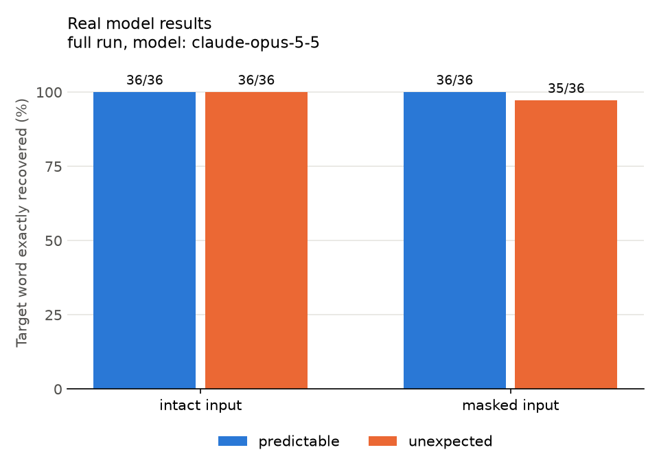

# When Context Guesses: full results

- Mode: real API
- Model: `claude-opus-5-5` (effort `medium`, max_tokens 16000)
- Dataset sha256: `3a584d44c3f30d2d7a10df7108ee08b1335daf1ad7d0ced7a6e22bb2aaf5458a`
- Seed: 20261022; prompt version: v2
- Requests in scope: 144 (12 pairs x 2 conditions x 2 input types x 3 repeats)

Timestamps, raw responses, and errors are in `cache/`, `attempts.jsonl`, and `runs/` in this mode's folder.

## Main analysis: target-word exact-match accuracy (all pairs)

Capitalization and surrounding punctuation are ignored; synonyms and misspellings count as wrong. Counts are over individual requests (each repeat counts once). Requests with an API, refusal, truncation, or parsing failure are excluded from the denominator and counted separately.

| input_type | condition | accuracy | failures |
|---|---|---|---|
| intact | predictable | 36/36 (100%) | 0 |
| intact | unexpected | 36/36 (100%) | 0 |
| masked | predictable | 36/36 (100%) | 0 |
| masked | unexpected | 35/36 (97%) | 0 |
| intact | all | 72/72 (100%) | 0 |
| masked | all | 71/72 (99%) | 0 |



## Pair outcomes (masked input)

An item counts as recovered when the target was exact in more than half of its 3 repeats. The answers column lists the word given in each repeat.

| pair_id | predictable_target | predictable_answers | predictable_correct | unexpected_target | unexpected_answers | unexpected_correct | outcome |
|---|---|---|---|---|---|---|---|
| P01 | teeth | teeth, teeth, teeth | 3/3 | horse | horse, horse, horse | 3/3 | both |
| P02 | water | water, water, water | 3/3 | gravy | gravy, gravy, gravy | 3/3 | both |
| P03 | chest | chest, chest, chest | 3/3 | piano | piano, piano, piano | 3/3 | both |
| P04 | cash | cash, cash, cash | 3/3 | corn | corn, corn, corn | 3/3 | both |
| P05 | building | building, building, building | 3/3 | aquarium | aquarium, aquarium, aquarium | 3/3 | both |
| P06 | plants | plants, plants, plants | 3/3 | camels | camels, camels, camels | 3/3 | both |
| P07 | hands | hands, hands, hands | 3/3 | forks | forks, forks, forks | 3/3 | both |
| P08 | umbrella | umbrella, umbrella, umbrella | 3/3 | suitcase | suitcase, suitcase, suitcase | 3/3 | both |
| P09 | knife | knife, knife, knife | 3/3 | sword | sword, sword, sword | 3/3 | both |
| P10 | thirsty | thirsty, thirsty, thirsty | 3/3 | curious | curious, furious, curious | 2/3 | both |
| P11 | mouth | mouth, mouth, mouth | 3/3 | purse | purse, purse, purse | 3/3 | both |
| P12 | tree | tree, tree, tree | 3/3 | shoe | shoe, shoe, shoe | 3/3 | both |

Pairs where only the predictable version was recovered: **0**. Only the unexpected version: **0**. Exact two-sided sign test on these discordant pairs: p = 1.000. With so few pairs this test can miss real differences, so a large p-value does not show the conditions are equal.

## Secondary analysis: excluding pairs flagged in review

Excludes P04, P05, P10 (9 pairs remain). This was specified before any real results and is reported regardless of whether it agrees with the main analysis.

| input_type | condition | accuracy | failures |
|---|---|---|---|
| intact | predictable | 27/27 (100%) | 0 |
| intact | unexpected | 27/27 (100%) | 0 |
| masked | predictable | 27/27 (100%) | 0 |
| masked | unexpected | 27/27 (100%) | 0 |
| intact | all | 54/54 (100%) | 0 |
| masked | all | 54/54 (100%) | 0 |

Masked pair outcomes: both: 9, neither: 0, predictable only: 0, unexpected only: 0, incomplete (failure): 0. Exact two-sided sign test on discordant pairs (0 vs 0): p = 1.000.

The visible-letter and word-frequency differences described below remain limitations in both analyses.

## Pair outcomes (intact control)

| pair_id | predictable_answers | unexpected_answers | outcome |
|---|---|---|---|
| P01 | teeth, teeth, teeth | horse, horse, horse | both |
| P02 | water, water, water | gravy, gravy, gravy | both |
| P03 | chest, chest, chest | piano, piano, piano | both |
| P04 | cash, cash, cash | corn, corn, corn | both |
| P05 | building, building, building | aquarium, aquarium, aquarium | both |
| P06 | plants, plants, plants | camels, camels, camels | both |
| P07 | hands, hands, hands | forks, forks, forks | both |
| P08 | umbrella, umbrella, umbrella | suitcase, suitcase, suitcase | both |
| P09 | knife, knife, knife | sword, sword, sword | both |
| P10 | thirsty, thirsty, thirsty | curious, curious, curious | both |
| P11 | mouth, mouth, mouth | purse, purse, purse | both |
| P12 | tree, tree, tree | shoe, shoe, shoe | both |

Intact requests where the model said it was not confident: 0/72.

## Did the model know when it might be wrong? (masked input)

The model reported `confident` (true/false) and `other_possible_words` with every answer. This is the model's own statement, not a measured probability.

| condition | right_and_confident | right_but_unsure | wrong_but_confident | wrong_and_unsure | wrong_but_target_listed_as_alternative |
|---|---|---|---|---|---|
| predictable | 36 | 0 | 0 | 0 | 0/0 |
| unexpected | 18 | 17 | 0 | 1 | 1/1 |

## Word familiarity and letter patterns

Number of words among the 50,000 most common English words (wordfreq list) that fit each blank pattern, ignoring the sentence. Rank 1 means the target is the most common word that fits. `word_frequency_zipf` is how common the target word is in general (about 3 = uncommon, 5 = very common). The list includes some names and abbreviations, so counts are approximate.

| item | target_word | word_frequency_zipf | pattern | words_that_fit | target_frequency_rank | most_frequent_fits | model_correct |
|---|---|---|---|---|---|---|---|
| P01-predictable | teeth | 4.58 | te_t_ | 5 | 2 | tests, teeth, texts | 3/3 |
| P01-unexpected | horse | 4.76 | ho_s_ | 4 | 2 | house, horse, hoist | 3/3 |
| P02-predictable | water | 5.52 | _a_er | 53 | 1 | water, later, paper | 3/3 |
| P02-unexpected | gravy | 3.48 | _r_vy | 2 | 1 | gravy, privy | 3/3 |
| P03-predictable | chest | 4.52 | __est | 6 | 2 | guest, chest, quest | 3/3 |
| P03-unexpected | piano | 4.31 | __ano | 3 | 1 | piano, plano, guano | 3/3 |
| P04-predictable | cash | 4.92 | __sh | 31 | 2 | wish, cash, fish | 3/3 |
| P04-unexpected | corn | 4.19 | __rn | 23 | 7 | turn, born, burn | 3/3 |
| P05-predictable | building | 5.29 | __ildi__ | 2 | 1 | building, childish | 3/3 |
| P05-unexpected | aquarium | 3.56 | __uari__ | 3 | 1 | aquarium, aquarius, squaring | 3/3 |
| P06-predictable | plants | 4.71 | p__nt_ | 9 | 3 | points, plenty, plants | 3/3 |
| P06-unexpected | camels | 3.3 | c__el_ | 3 | 1 | camels, cowell, canelo | 3/3 |
| P07-predictable | hands | 5.16 | han__ | 8 | 1 | hands, handy, hangs | 3/3 |
| P07-unexpected | forks | 3.45 | for__ | 15 | 8 | force, forms, forth | 3/3 |
| P08-predictable | umbrella | 3.89 | u__r__la | 1 | 1 | umbrella | 3/3 |
| P08-unexpected | suitcase | 3.55 | s__t__se | 2 | 1 | suitcase, synthase | 3/3 |
| P09-predictable | knife | 4.41 | _nif_ | 3 | 1 | knife, sniff, unify | 3/3 |
| P09-unexpected | sword | 4.37 | _wor_ | 3 | 1 | sword, sworn, swore | 3/3 |
| P10-predictable | thirsty | 3.74 | _h_rs_y | 1 | 1 | thirsty | 3/3 |
| P10-unexpected | curious | 4.45 | _u_io_s | 4 | 1 | curious, furious, dubious | 2/3 |
| P11-predictable | mouth | 4.83 | mo_t_ | 6 | 2 | month, mouth, motto | 3/3 |
| P11-unexpected | purse | 3.95 | pu_s_ | 3 | 3 | pussy, pulse, purse | 3/3 |
| P12-predictable | tree | 4.85 | __ee | 12 | 2 | free, tree, knee | 3/3 |
| P12-unexpected | shoe | 4.24 | __oe | 3 | 1 | shoe, aloe, oboe | 3/3 |

## Items for manual review

Every item with a wrong target word, a visible-character violation, or a failure. A wrong answer is not automatically a 'predictability bias': record your judgment in the `reviewer_more_conventional_substitution` column of `error_table.csv` (kept when the report is regenerated).

| item_id | model_input | reconstruction | target_word | recovered_word | target_correct | confident | other_possible_words | visible_char_violation | failure | reviewer_more_conventional_substitution |
|---|---|---|---|---|---|---|---|---|---|---|
| P10-unexpected-masked-r2 | After the long hike, we were very _u_io_s. | After the long hike, we were very furious. | curious | furious | no | no | curious, dubious | no |  |  |

## Failures and violations

- Visible-character violations: 0
- API errors: 0
- Refusals: 0
- Truncated responses: 0
- Parsing failures: 0

## Prompt (identical for every item)

```text
You will see one English sentence. Some letters may have been replaced with underscores (_). Each underscore stands for exactly one missing letter.

Reconstruct the complete sentence.
- Copy every visible character exactly as shown, including capitalization, spaces, and punctuation.
- Replace each underscore with exactly one letter.
- If the sentence contains no underscores, return it exactly as shown.

Also report:
- "confident": true if you are confident your reconstruction matches the original sentence, otherwise false.
- "other_possible_words": any other words that could have been the original where letters are missing. Use an empty list if there are none.

<sentence>{sentence}</sentence>
```

## Interpretation

This report is generated and contains no conclusions. The author's interpretation is in `docs/lab_notebook.md`. Twelve author-labeled pairs and one run of one model cannot establish a general finding, and this text task does not transfer directly to neural speech decoding.
